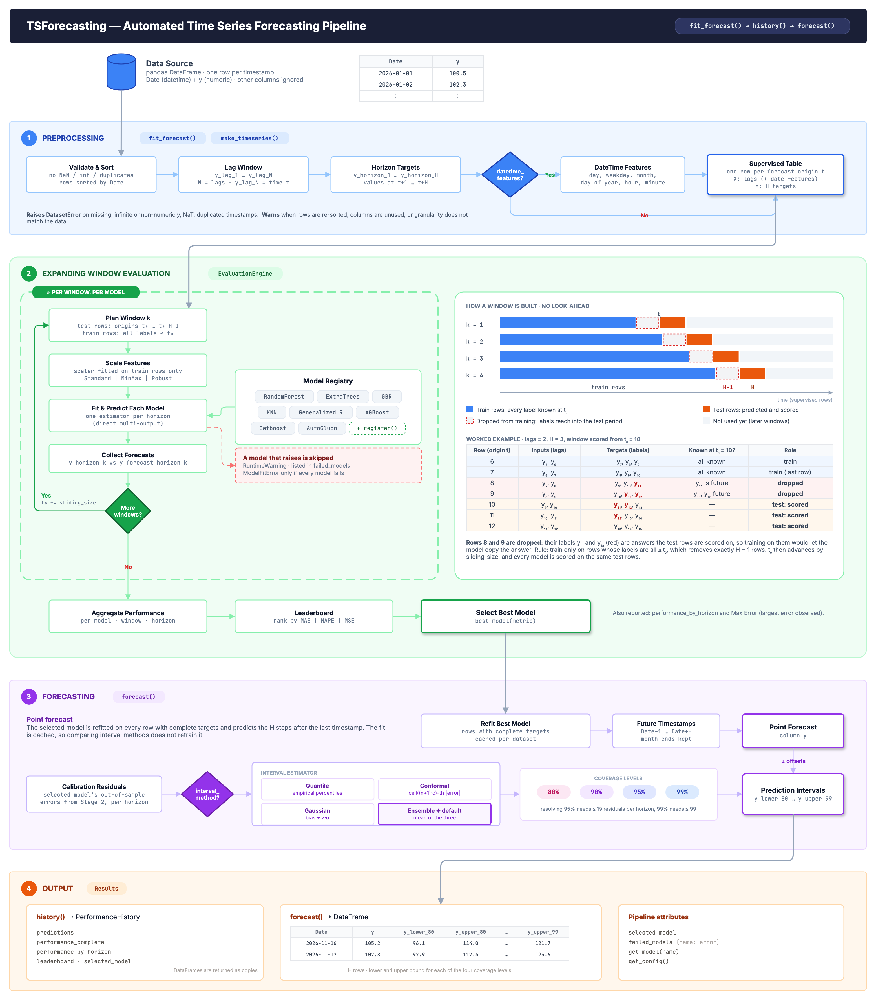

[![LinkedIn][linkedin-shield]][linkedin-url]
[![Contributors][contributors-shield]][contributors-url]
[![Stargazers][stars-shield]][stars-url]
[![MIT License][license-shield]][license-url]
[![Downloads][downloads-shield]][downloads-url]
[![Monthly Downloads][downloads-month-shield]][downloads-month-url]

[contributors-shield]: https://img.shields.io/github/contributors/TsLu1s/TSForecasting.svg?style=for-the-badge&logo=github&logoColor=white
[contributors-url]: https://github.com/TsLu1s/TSForecasting/graphs/contributors
[stars-shield]: https://img.shields.io/github/stars/TsLu1s/TSForecasting.svg?style=for-the-badge&logo=github&logoColor=white
[stars-url]: https://github.com/TsLu1s/TSForecasting/stargazers
[license-shield]: https://img.shields.io/github/license/TsLu1s/TSForecasting.svg?style=for-the-badge&logo=opensource&logoColor=white
[license-url]: https://github.com/TsLu1s/TSForecasting/blob/main/LICENSE
[linkedin-shield]: https://img.shields.io/badge/-LinkedIn-black.svg?style=for-the-badge&logo=linkedin&colorB=555
[linkedin-url]: https://www.linkedin.com/in/luisfssantos98/
[downloads-shield]: https://static.pepy.tech/personalized-badge/tsforecasting?period=total&units=international_system&left_color=grey&right_color=blue&left_text=Total%20Downloads
[downloads-url]: https://pepy.tech/project/tsforecasting
[downloads-month-shield]: https://static.pepy.tech/personalized-badge/tsforecasting?period=month&units=international_system&left_color=grey&right_color=blue&left_text=Monthly%20Downloads
[downloads-month-url]: https://pepy.tech/project/tsforecasting

<br>
<p align="center">
  <h2 align="center"> TSForecasting: Automated Time Series Forecasting Framework
  <br>

## Framework Contextualization <a name = "ta"></a>

The `TSForecasting` project offers a comprehensive and integrated pipeline designed to Automate Time Series Forecasting applications. By implementing multivariate approaches that incorporate multiple regression models, it combines varied relevant modules such as `SKLearn`, `AutoGluon`, `CatBoost` and `XGBoost`, following an `Expanding Window` structured approach for performance evaluation ensuring a robust, scalable and optimized forecasting solution.

The architecture design includes five main sections: data preprocessing, feature engineering, hyperparameter optimization, model evaluation and forecasting, which are organized and customizable in a pipeline structure.

This project aims at providing the following application capabilities:

* **General applicability on tabular datasets**: The developed forecasting procedures are applicable on any data table associated with any Time Series Forecasting scopes.

* **Hyperparameter optimization and customization**: It provides full configuration for each model hyperparameter through the customization of `model_configurations` dictionary, allowing optimal performance to be obtained for any use case.
    
* **Robustness and improvement of predictive results**: The implementation of the TSForecasting pipeline aims to improve the predictive performance directly associated with the application of the best performing forecasting method.

* **Prediction intervals with multiple methods**: Four coverage levels (80%, 90%, 95%, 99%) with four estimation methods (ensemble, quantile, conformal, gaussian) for robust uncertainty quantification.

#### Main Development Tools <a name = "pre1"></a>

Major frameworks used to build this project: 

* [Sklearn](https://scikit-learn.org/stable/)
* [AutoGluon](https://auto.gluon.ai/stable/index.html)
* [CatBoost](https://catboost.ai/)
* [XGBoost](https://xgboost.readthedocs.io/en/stable/)

## Pipeline Architecture <a name = "ta"></a>

<p align="center">
  <a href="https://raw.githubusercontent.com/TsLu1s/tsforecasting/main/docs/TSForecasting_Pipeline_Diagram.png">
    
  </a>
</p>

The pipeline runs in four stages:

1. **Preprocessing**: validates the input (rows sorted by date; missing values and duplicated timestamps rejected) and turns the series into a supervised table of lag features and multi-step horizon targets, with optional datetime features.
2. **Expanding Window Evaluation**: the training set grows by `sliding_size` on each iteration and the next `horizon` steps are forecast. The `horizon - 1` rows whose targets reach past the forecast origin are purged, so scores are free of look-ahead leakage. The scaler is fitted on each window's training rows only, and a model that fails is skipped and reported in `failed_models`.
3. **Model Selection**: errors (MAE, MAPE, MSE, Max Error) are aggregated across windows and horizons into a leaderboard, and the best model by the chosen `metric` is selected.
4. **Forecasting**: the selected model is refitted on every row with complete targets and predicts the future timestamps, with prediction intervals at 80%, 90%, 95% and 99% coverage (`ensemble`, `quantile`, `conformal` or `gaussian`).

## Where to get it <a name = "ta"></a>

Binary installer for the latest released version is available at the Python Package Index (PyPI).   

## Installation  

To install this package from Pypi repository run the following command:

```
pip install tsforecasting
```

Python 3.10 or newer is required.

# Usage Examples
    
## 1. TSForecasting - Automated Time Series Forecasting

The first step after importing the package is to load a dataset and define your DateTime (`datetime64[ns]` type) and Target column to be predicted, then rename them to `Date` and `y`, respectively.

**Input data requirements:** one row per timestamp at regular spacing, a datetime `Date` column and a numeric `y` column without missing values. Rows are sorted chronologically when needed (with a warning); duplicated timestamps, missing or non-numeric targets raise a `DatasetError` with a description of the problem. Columns other than `Date` and `y` are ignored.

The pipeline follows a straightforward workflow: configure parameters, fit the model across expanding windows, evaluate performance, and generate forecasts with prediction intervals. The `fit_forecast` method trains and evaluates all selected models using the expanding window approach, automatically selecting the best performer. The `history` method returns detailed performance metrics across all windows and horizons, while `forecast` generates future predictions using the best model.

**Pipeline Parameters:**

* `train_size`: Proportion of data used for the initial training window (`0.3 <= train_size < 1.0`)
* `lags`: Number of lag features (window size) - how many past observations each input sample includes
* `horizon`: Number of future time steps to forecast
* `sliding_size`: Window expansion size per iteration (`sliding_size >= horizon` recommended)
* `models`: List of models to evaluate (names are case-insensitive). Available options:
  * `RandomForest`, `ExtraTrees`, `GBR`, `KNN`, `GeneralizedLR`
  * `XGBoost`,`Catboost`, `AutoGluon`
  * any model added with `ModelRegistry.register` (see [Custom Models](#5-custom-models))
* `hparameters`: Nested dictionary containing model-specific hyperparameter configurations (customizable via `model_configurations()`)
* `granularity`: Time frequency of the data - `1m`, `30m`, `1h`, `1d`, `1wk`, `1mo` (default: `1d`). It drives the timestamps of the forecast; a warning is raised when it does not match the spacing of `Date`
* `metric`: Evaluation metric for model selection - `MAE`, `MAPE`, or `MSE` (default: `MAE`)
* `scaler`: Feature scaler - `standard`, `minmax`, `robust` (default: `standard`)
* `datetime_features`: Whether date-based features are added to the lag features (default: `True`)
* `verbose`: Whether evaluation progress is printed (default: `True`)

Invalid parameters raise a `ConfigurationError` (an unknown model raises `ModelNotFoundError`), both when constructing the pipeline and when using the builder.

```py
import warnings
import pandas as pd
from tsforecasting import TSForecasting, model_configurations

warnings.filterwarnings("ignore", category=Warning)

# Load and prepare data
data = pd.read_csv("your_timeseries.csv")
data = data.rename(columns={"DateTime_Column": "Date", "Target_Column": "y"})
data["Date"] = pd.to_datetime(data["Date"])
data = data[["Date", "y"]]

# Get and customize model hyperparameters
hparameters = model_configurations()
hparameters["RandomForest"]["n_estimators"] = 100
hparameters["XGBoost"]["n_estimators"] = 100
hparameters["Catboost"]["iterations"] = 100

# Configure and fit pipeline
tsf = TSForecasting(
    train_size=0.80,
    lags=10,
    horizon=10,
    sliding_size=10,
    models=[
        "RandomForest",
        "ExtraTrees",
        "GBR",
        "KNN",
        "XGBoost",
        "Catboost",
    ],
    hparameters=hparameters,
    granularity="1d",
    metric="MAE",
)
tsf.fit_forecast(dataset=data)

# Get performance history
history = tsf.history()
print(f"Best Model: {tsf.selected_model}")

# A model that raises during evaluation is skipped (with a warning) instead of
# aborting the run; skipped models and their errors are listed here
print(tsf.failed_models)

# Generate forecast with prediction intervals
forecast = tsf.forecast()
print(forecast[["Date", "y", "y_lower_90", "y_upper_90"]])
```

### Performance Analysis

The `history()` method returns a `PerformanceHistory` dataclass containing detailed evaluation results essential for analyzing forecasting performance across models, windows, and horizons.

```py
# Access history components
history = tsf.history()

# 1. Predictions DataFrame - Raw forecasts per window with timestamps
predictions = history.predictions
print(f"Shape: {predictions.shape}")
print(predictions.head())
# Columns: Date, y_horizon_1..N, y_forecast_horizon_1..N, Window, Model

# 2. Complete Performance - Detailed metrics per window and horizon
performance_complete = history.performance_complete
print(performance_complete.head(10))
# Columns: Model, Window, Horizon, Mean Absolute Error,
#          Mean Absolute Percentage Error, Mean Squared Error, Max Error

# 3. Performance by Horizon - Aggregated metrics across windows per horizon
performance_horizon = history.performance_by_horizon
print(performance_horizon)
# Useful for understanding error growth over forecast horizon

# 4. Leaderboard - Model rankings by selected metric
leaderboard = history.leaderboard
print(leaderboard.to_string(index=False))
# Models ranked by mean performance across all windows
# ("Max Error" reports the largest single error observed)

# 5. Selected Model
print(f"Best Model: {history.selected_model}")
```

## 2. Builder Pattern (Alternative Configuration)

For more readable configuration, use the fluent builder pattern:

```py
from tsforecasting import TSForecastingBuilder

tsf = (TSForecastingBuilder()
       .with_train_size(0.80)
       .with_lags(10)
       .with_horizon(10)
       .with_sliding_size(10)
       .with_models(['RandomForest', 'XGBoost'])
       .with_granularity('1d')
       .with_metric('MAE')
       .with_preprocessing(scaler='robust', datetime_features=True)
       .build())

tsf.fit_forecast(dataset=data)
forecast = tsf.forecast()
```

## 3. Prediction Intervals

TSForecasting generates prediction intervals at four fixed coverage levels: **80%, 90%, 95%, and 99%**. Four estimation methods are available:

| Method | Description | Best For |
|--------|-------------|----------|
| `ensemble` | Average of all three methods (default) | General use, most robust |
| `quantile` | Empirical percentiles of residuals | Asymmetric error distributions |
| `conformal` | Distribution-free coverage guarantee | Theoretical guarantees |
| `gaussian` | Parametric normal assumption | Symmetric, well-behaved errors |

**Mathematical Formulations:**

* **Quantile**: Computes empirical percentiles of historical residuals (`lower = forecast + percentile(residuals, α/2)`). Captures asymmetric errors without distributional assumptions.

* **Conformal**: Uses absolute errors as nonconformity scores and takes the `ceil((n + 1) × coverage)`-th smallest score (finite-sample correction). Provides coverage guarantees with symmetric, constant-width intervals.

* **Gaussian**: Assumes normally distributed residuals (`lower = forecast + bias - z × std`). Efficient and accounts for systematic bias.

* **Ensemble** (Default): Averages bounds from all three methods, balancing their strengths for robust uncertainty estimates.

```py
# Default: ensemble method (recommended)
forecast = tsf.forecast()

# Specific methods
forecast = tsf.forecast(interval_method="quantile")
forecast = tsf.forecast(interval_method="conformal")
forecast = tsf.forecast(interval_method="gaussian")
```

The final model fit is cached, so comparing interval methods on the same data does not retrain the model.

**Calibration notes:** intervals are calibrated per horizon on the out-of-sample residuals of the selected model collected during the expanding window evaluation (`n = windows × horizon` residuals per horizon). 
Empirical bounds cannot extend beyond the most extreme residual observed, so high coverage levels need enough residuals to be resolved - roughly `n >= 19` for 95% and `n >= 99` for 99%. 
With fewer, the 95% and 99% intervals are narrower than their nominal level; use a smaller `sliding_size` or more data to obtain more evaluation windows.

## 4. Auxiliary Methods

### Processing - Time Series Transformation

The `make_timeseries` method transforms a DataFrame into a supervised learning format ready for time series analysis:

* `window_size`: Number of past observations (lags) each sample includes
* `horizon`: Number of future time steps to predict
* `datetime_engineering`: Enriches dataset with date-time features (year, month, day of week, etc.)

```py
from tsforecasting import Processing

processor = Processing()
timeseries = processor.make_timeseries(
    dataset=data,
    window_size=10,
    horizon=5, 
    datetime_engineering=True
)
```

### TreeBasedFeatureSelector - Feature Selection

Select most relevant features based on tree-based importance:

```py
from tsforecasting import TreeBasedFeatureSelector

selector = TreeBasedFeatureSelector(
    algorithm='ExtraTrees',      # RandomForest, ExtraTrees, GBR
    relevance_threshold=0.95,    # Keep features explaining 95% of variance
    n_estimators=100
)
selector.fit(X, y)
X_selected = selector.transform(X)
print(selector.selected_features)
```

## 5. Custom Models

Any estimator with a scikit-learn style `fit`/`predict` can take part in the evaluation: wrap it in a `BaseForecaster` subclass and register it. Registered models are selected by name like the built-in ones.

```py
from sklearn.linear_model import Ridge
from tsforecasting import BaseForecaster, ModelRegistry, TSForecasting

class RidgeForecaster(BaseForecaster):
    def _create_base_estimator(self):
        return Ridge(**self._params)

ModelRegistry.register("Ridge", RidgeForecaster, default_params={"alpha": 1.0})

tsf = TSForecasting(lags=10, horizon=5, sliding_size=5, models=["Ridge", "RandomForest"])
tsf.fit_forecast(dataset=data)
```

## 6. Error Handling

All exceptions derive from `TSForecastingError`:

| Exception | Raised when |
|-----------|-------------|
| `ConfigurationError` | A pipeline parameter is out of range or not recognised |
| `ModelNotFoundError` | A model name is not registered |
| `DatasetError` | The dataset is malformed (missing columns, NaN/non-numeric target, duplicated timestamps) |
| `InsufficientDataError` | The dataset is too small for the requested `lags`, `horizon`, `train_size` and `sliding_size` |
| `ModelFitError` | Every candidate model failed during evaluation |
| `NotFittedError` | `history()` or `forecast()` is called before `fit_forecast()` |

Input-related errors (`ConfigurationError`, `ModelNotFoundError`, `DatasetError`, `InsufficientDataError`) are also `ValueError` subclasses.

### Detailed Timeseries Examples

[TSForecasting Guideline Examples](https://github.com/TsLu1s/tsforecasting/tree/main/examples)

## Interactive Notebooks

For a more interactive experience, feel free to explore the Jupyter notebooks with step-by-step execution and guidelines:

📓 **[Interactive Notebooks](https://github.com/TsLu1s/tsforecasting/blob/main/examples/notebooks)**

## Citation

If you use TSForecasting in your research, please cite:
```bibtex
@software{tsforecasting,
  author = {Luis Fernando Santos},
  title = {TSForecasting: Automated Time Series Forecasting Framework},
  year = {2022},
  url = {https://github.com/TsLu1s/TSForecasting}
}
```

## License

Distributed under the MIT License. See [LICENSE](https://github.com/TsLu1s/TSForecasting/blob/main/LICENSE) for more information.

## Contact
 
Luis Santos - [LinkedIn](https://www.linkedin.com/in/lu%C3%ADsfssantos/)
